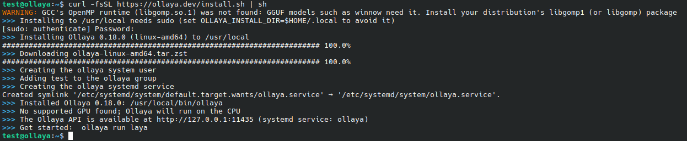
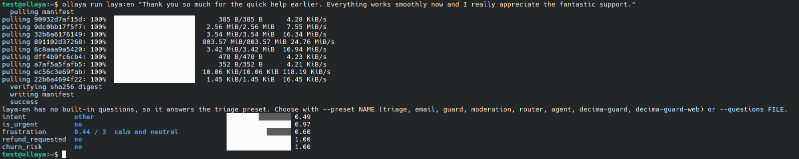
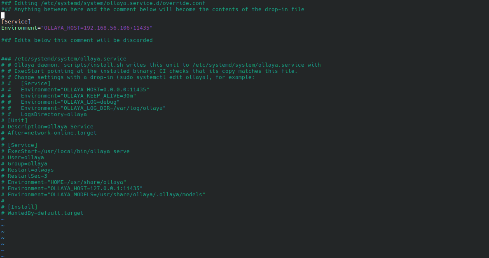
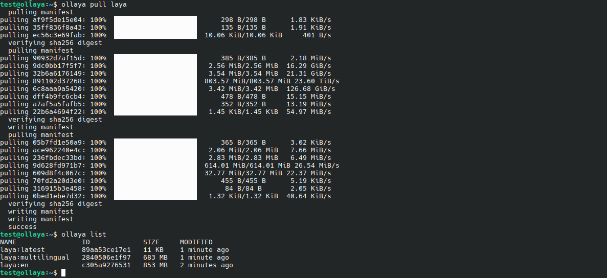
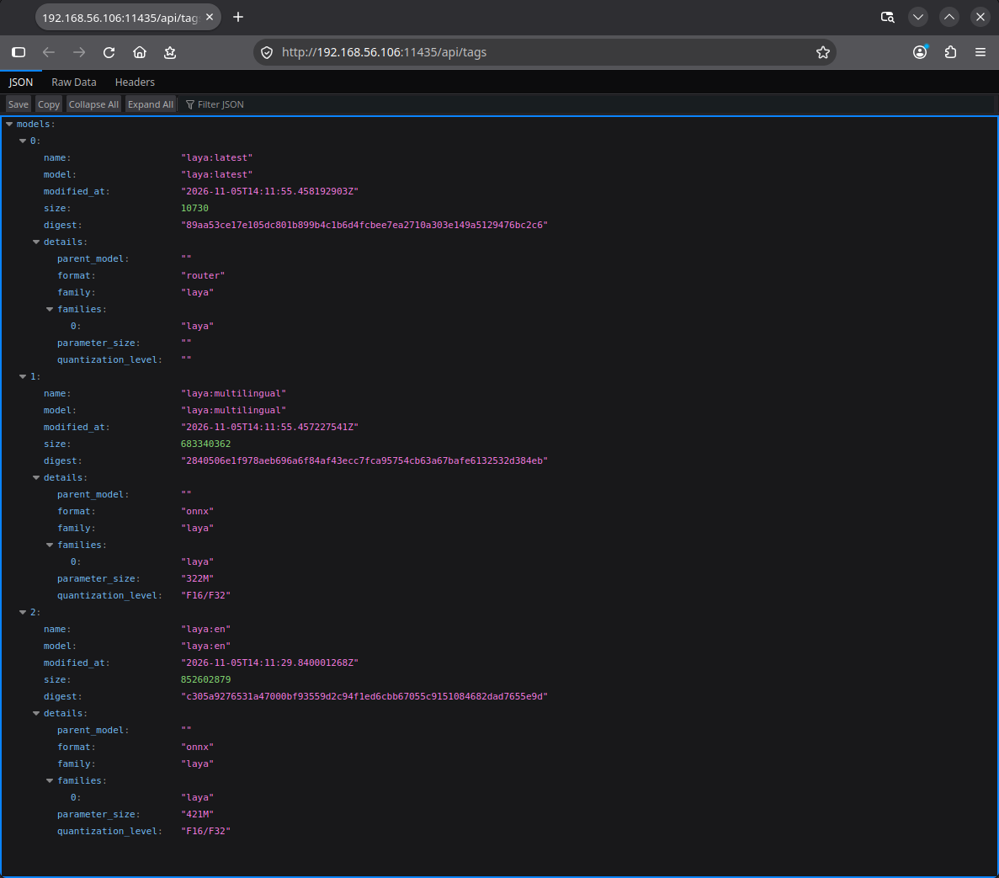
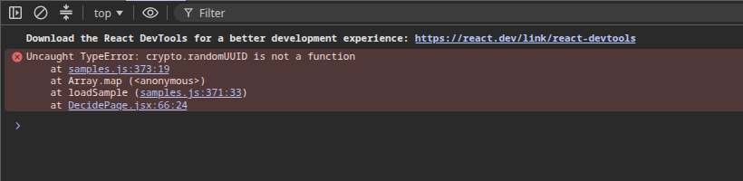
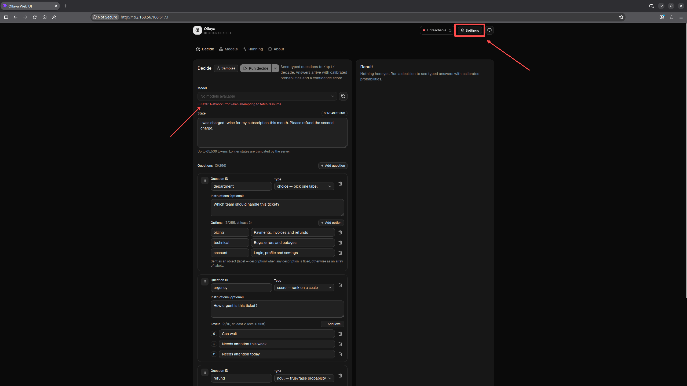
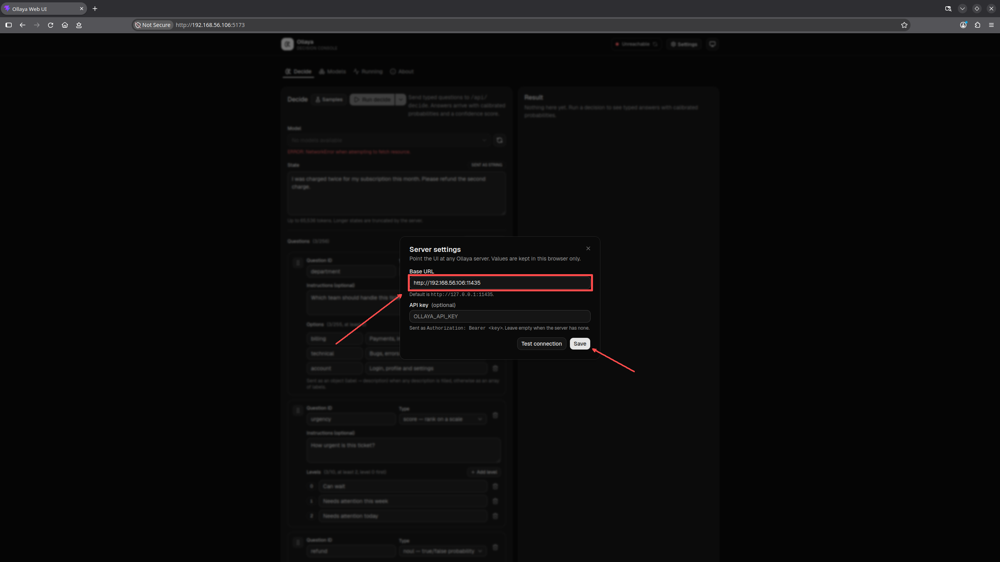
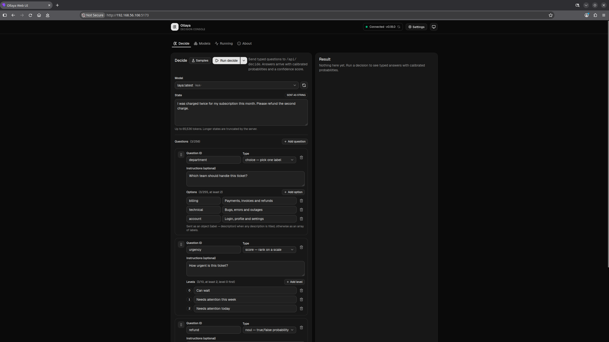

# Ollaya

A hands-on tutorial for Ollaya showing how to run fast, local decision models for instant classification, routing, and guardrails

<picture>
  <source media="(prefers-color-scheme: dark)" srcset="misc/logo/logo-light.png">
  <source media="(prefers-color-scheme: light)" srcset="misc/logo/logo-dark.png">
  
</picture>
<br />
<br />

[Ollaya](https://ollaya.dev) is an open source local runtime built specifically for **decision models**. Instead of waiting seconds for a generative LLM to output and parse JSON while burning expensive API tokens in the process, Ollaya evaluates an input state (such as an email, ticket, or JSON payload) and a typed question, then returns deterministic choices with calibrated probabilities in a single forward pass within milliseconds. Running entirely on your local machine (CPU or GPU), it ensures complete data privacy with no token fees. This makes it ideal for real time tasks like support ticket triage, agent guardrails, tool call validation, and high throughput query routing.

## Motivation

When building automated workflows, I kept hitting the same wall. Using generative models for simple boolean true or false decisions, categorization, and routing felt completely unnecessary. I was waiting hundreds of milliseconds, and often several seconds, just to receive a small structured response that labeled an email or picked a department. On top of the frustrating latency, models would occasionally produce invalid formats that broke my code. I realized that a full text generation model is simply the wrong tool for pure logic and classification. That led me to Ollaya. It solved these issues immediately by running dedicated decision models directly on my local machine, giving me instant, typed answers with calibrated confidence scores and complete data privacy.

## Installation

Install Ollaya with a single command. By default, it prompts for sudo to install to `/usr/local` and configure a background service, but it can also be installed completely without root permissions by setting `OLLAYA_INSTALL_DIR=$HOME/.local`.

```bash
curl -fsSL https://ollaya.dev/install.sh | sh
```



## Run Your First Decision Model

```bash
ollaya run laya:en "Thank you so much for the quick help earlier. Everything works smoothly now and I really appreciate the fantastic support."
```

## Expected output

Each row shows a specific evaluated attribute alongside its predicted label and confidence score. High values near one confirm clear gratitude with zero frustration or churn indicators, making this safe to archive without human intervention.

```bash
intent            other                                 ████████░░░░░░░░ 0.49
is_urgent         no                                    ████████████████ 0.97
frustration       0.44 / 3  calm and neutral            ██████████░░░░░░ 0.60
refund_requested  no                                    ████████████████ 1.00
churn_risk        no
```

The result will look like that.



## Access Ollaya from Your Host Browser

You can query Ollaya directly from your host browser across a VirtualBox Host Only network adapter. First find the IP address assigned to your virtual machine on the host only network.

```bash
# Show all network interfaces and addresses
ip a

# Or show IPv4 addresses only
ip -4 addr show
```

Look for the adapter address such as `192.168.56.106`.

Note, Your actual IP address may differ (especially the last octet, e.g., `192.168.56.X`). Be sure to use the IP address assigned to your virtual machine.

Next, configure the Ollaya system service to accept connections from your host machine. Instead of binding to all interfaces `0.0.0.0`, bind strictly to your VirtualBox Host-Only IP address `192.168.56.106` for better security.

Create a systemd override for the service using Vim (or Nano).

```bash
sudo apt install -y vim
sudo SYSTEMD_EDITOR=vim systemctl edit ollaya.service
```

Add the following lines inside the text editor.

```bash
[Service]
Environment="OLLAYA_HOST=192.168.56.106:11435"
```



Save and exit `:wq` (or `Ctrl+O`, `Enter`, then `Ctrl+X` in Nano).

Then reload the systemd daemon and restart the service.

```bash
sudo systemctl daemon-reload
sudo systemctl restart ollaya.service
sudo systemctl status ollaya.service
```

Now download the `laya` base decision model and verify.

```bash
# Download the model
ollaya pull laya

# Verify that the model family is available
ollaya list
```



Once running, switch to the browser on your host (main) computer and test the connection by visiting the tags endpoint :smile:

```bash
http://192.168.56.106:11435/api/tags
```



Another option is to Keep localhost and use SSH port forwarding, this is the most secure practice because Ollaya remains safely bound to `127.0.0.1` inside the VM (by editing the systemd service or manually), and all traffic passes through an encrypted tunnel from your host computer.

Start Ollaya normally on localhost inside the VM.

```bash
ollaya serve
```

On your host machine, open a terminal and run an SSH local port forward to your VM host only IP address.

```bash
ssh -L 11435:127.0.0.1:11435 your_vm_user@192.168.56.106
```

If you prefer to run Ollaya across the private adapter directly, you can also use `ufw` inside the VM to allow traffic only from your host machine IP.

```bash
sudo ufw default deny incoming
sudo ufw allow from 192.168.56.1 to any port 11435 proto tcp
sudo ufw enable
```

Here `192.168.56.1` represents your host operating system IP address on the VirtualBox adapter, ensuring only your host computer can connect.

## Ollaya Web UI

This section covers how to set up the Ollaya Web UI (on VM) and access the interface from host locally.

Update system packages and install Node.js (LTS), npm, and git.

```bash
# Necessary packages
sudo apt update
sudo apt install -y git nodejs npm
node -v
npm -v
git --version
sudo SYSTEMD_EDITOR=vim systemctl edit ollaya.service

# Add the following lines
[Service]
Environment="OLLAYA_HOST=192.168.56.106:11435"
Environment="OLLAYA_ORIGINS=*"

# Reload systemd and restart the service
sudo systemctl daemon-reload
sudo systemctl restart ollaya

# Allow incoming traffic
sudo ufw allow 11435/tcp
sudo ufw allow 5173/tcp
```

Clone and Install Dependencies, run these commands as a standard (non-root) user.

```bash
git clone https://github.com/ollaya-dev/ollaya-web-ui.git
cd ollaya-web-ui
npm install
```

Add this small script tag inside `<head>` (right before other scripts). Even on the latest Firefox, `crypto.randomUUID()` is disabled on plain HTTP (insecure contexts like local LAN IP addresses).This polyfill falls back to `crypto.getRandomValues()` so the app can still generate UUIDs without crashing.



```bash
cd ollaya-web-ui
vim index.html

<script>
  if (!window.crypto || !window.crypto.randomUUID) {
    window.crypto = window.crypto || {};
    window.crypto.randomUUID = function() {
      return '10000000-1000-4000-8000-100000000000'.replace(/[018]/g, c =>
        (c ^ crypto.getRandomValues(new Uint8Array(1))[0] & 15 >> c / 4).toString(16)
      );
    };
  }
</script>
```

Save, then Run Vite with host flag.

```bash
cd ollaya-web-ui
npm run dev -- --host
```

Open your browser and navigate to `http://192.168.56.106:5173`. Click the Settings (gear :gear:) icon in the header, update the server URL from `http://127.0.0.1:11435` to `http://192.168.56.106:11435`, and save your changes. Setup is now complete!

|                    Step 1                    |                    Step 2                    |                  Have fun!                   |
| :------------------------------------------: | :------------------------------------------: | :------------------------------------------: |
|  |  |  |

## Automated Support Ticket Triage Example

This example demonstrates automated customer support triage using Ollaya’s decision API. The OllayaClient class sends incoming customer messages to the triage model, extracts structured signals such as intent, frustration, and urgency, and then routes the ticket to the correct department while escalating time sensitive issues in real time.

### Python

```bash
cd examples
python3 ollaya_client.py

Analyzing: "Hi team, we have a major client presentation in 3 hours and our team dashboard is showing an unexpected 500 error when loading reports. Could someone please help us get this back up urgently? Thank you!"

--- Ticket Routing Report ---
Primary Intent : technical_help
Frustration    : 0.99 / 3.0
Routing Actions:
  • ROUTE -> Priority set to HIGH / P1
  • QUEUE -> Tier 2 Technical Support

```

### Shell Script

```bash
cd examples
chmod +x ollaya_client.sh
./ollaya_client.sh

Analyzing: "Hi team, we have a major client presentation in 3 hours and our team dashboard is showing an unexpected 500 error when loading reports. Could someone please help us get this back up urgently? Thank you!"

--- Ticket Routing Report ---
Primary Intent : technical_help
Frustration    : 0.99 / 3.0
Routing Actions:
  • ROUTE -> Priority set to HIGH / P1
  • QUEUE -> Tier 2 Technical Support
```

### Rust

```bash
sudo apt update
sudo apt install -y curl build-essential pkg-config libssl-dev
curl --proto '=https' --tlsv1.2 -sSf https://sh.rustup.rs | sh -s -- -y
source "$HOME/.cargo/env"
cargo --version
rustc --version
cd examples/rust
cargo run

    Updating crates.io index
     Locking 156 packages to highest compatible versions
      Adding reqwest v0.12.28 (available: v0.13.5)
  Downloaded atomic-waker v1.1.2
  Downloaded futures-io v0.3.34
  ...
   Compiling mime v0.3.18
   Compiling base64 v0.22.1
   Compiling reqwest v0.12.28
   Compiling ollaya-client v0.1.0 (/home/test/examples/rust)
    Finished `dev` profile [unoptimized + debuginfo] target(s) in 15.75s
     Running `target/debug/ollaya-client`
Analyzing: "Hi team, we have a major client presentation in 3 hours and our team dashboard is showing an unexpected 500 error when loading reports. Could someone please help us get this back up urgently? Thank you!"

--- Ticket Routing Report ---
Primary Intent : technical_help
Frustration    : 0.99 / 3.0
Routing Actions:
  • ROUTE -> Priority set to HIGH / P1
  • QUEUE -> Tier 2 Technical Support
```

## License

MIT - See the [LICENSE](https://github.com/ncklinux/Ollaya/blob/main/LICENSE) file in this project for details.

## Disclaimer

This project is currently under development, distributed FREE & WITHOUT ANY WARRANTY. Report any bugs or suggestions as an [issue](https://github.com/ncklinux/Ollaya/issues/new).

## Commit Messages

This repository follows the [Conventional Commits](https://www.conventionalcommits.org) specification, the commit message should never exceed 100 characters and must be structured as follows:

```
<type>[optional scope]: <description>

[optional body]

[optional footer(s)]
```

## Note

I will keep and maintain this project as open source forever! [Watch it](https://github.com/ncklinux/Ollaya/subscription), give it a :star: and follow me.

## Powered by


